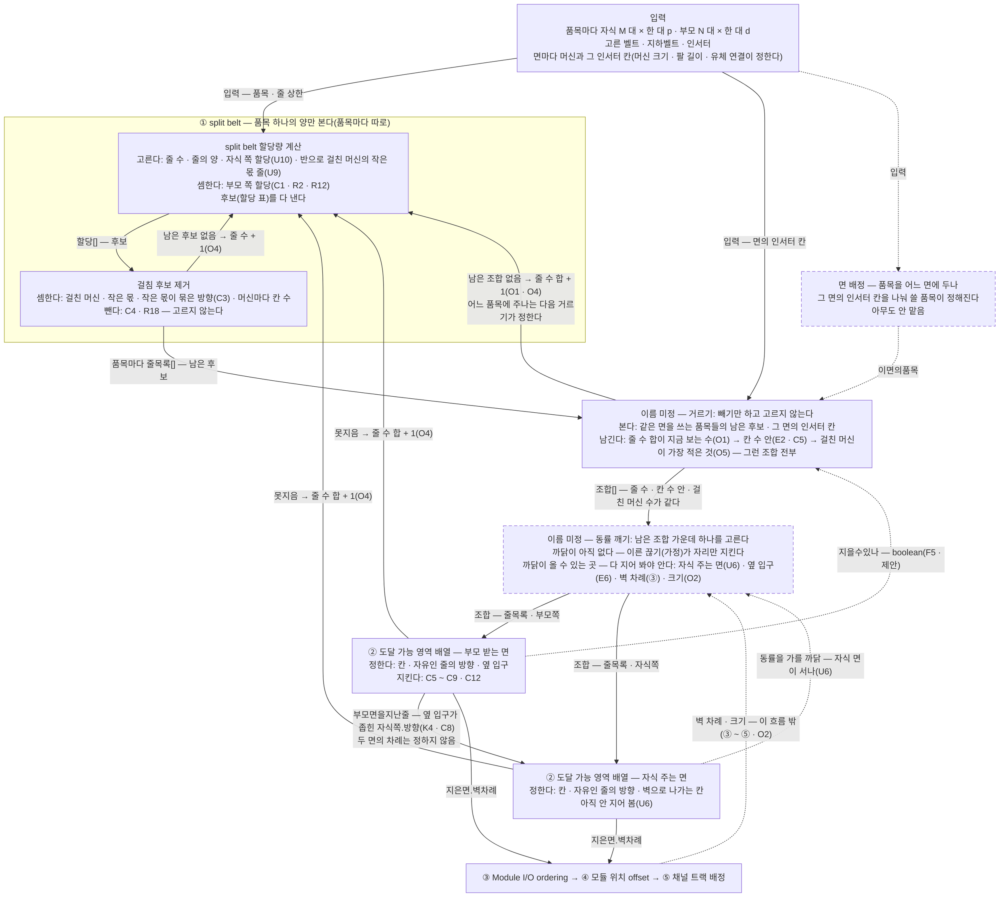

# 흐름 — 줄 하나가 양에서 칸이 되기까지

> 2026-10-26 초안 · **2026-10-27 고침** — split belt 를 두 단계(**split belt 할당량 계산** · **걸침 후보 제거**)로 나누고, 품목마다 후보 하나를 고르는 단계를 따로 세웠다(**이름 미정** — 구현한 뒤 이름을 짓는다). 단계 이름은 사용자가 정했다.
> **2026-10-28 고침** — 이름 미정의 단계를 **거르기**(셀 수 있는 것으로 빼기만 하고 고르지 않는다)와 **동률 깨기**(남은 조합 가운데 하나를 고른다 — 까닭이 아직 없다)로 나눴다(사용자 *"좋습니다"*). 줄을 늘릴 품목은 거르기가 정한다(O1 에서 따라 나옴 · AI). 보기 2(품목 둘이 한 면을 쓴다)를 더하고, 열린 물음을 *정하려면 무엇이 먼저 드나* 로 묶었다.
> **2026-10-28 정의 2판** — 정의를 이 흐름에 맞춰 다시 짰다([2판](split-belt-문제와-도달-가능-영역-배열-문제-정리-2판.md)). 단계표 · 흐름도 · 타입 · 보기는 여기가 단일 출처이고, 규칙의 까닭 · 단계마다 쓰는 규칙 · 열린 물음 · 다음 일은 2판에 있다.
> 같은 날 보기 1 · 2 의 꼴 수를 고쳤다 — 정확히 반을 한쪽으로 읽은 후보를 그쪽이 작은 몫인 꼴과 따로 세어 부풀렸다(내력).
> 사용자가 이 그림이 맞다고 했다(2026-10-27). 정의의 표(R · C · O · U)는 2판에서 찾아보기로 내렸고, 상자에서 번호로 가리킨다.
> 그림은 Mermaid 다(Obsidian 에서 그림으로 보인다).

## 세 문장

1. 줄 하나는 **자식 면에서 시작해 부모 면에서 끝난다.**
2. **split belt** 는 품목마다 그 품목의 양만 보고 후보(머신마다 줄마다 할당량을 적은 표)를 다 낸 뒤, 게임 규칙에 걸리는 후보를 뺀다.
   **이름 미정의 단계** 가 같은 면을 쓰는 품목들을 함께 본다 — 품목마다 후보 하나씩 고른 조합을 셀 수 있는 것(줄 수 · 칸 수 · 걸친 머신 수)으로 거르고(**거르기**), 남은 조합 가운데 하나를 고른다(**동률 깨기**).
   고른 조합이 줄 목록(작은 몫 · 작은 몫이 묶은 방향)이다. **도달 가능 영역 배열** 은 두 면에서 그 줄들을 칸에 앉힌다.
3. 거르기와 배열은 **같은 자원(인서터 칸)을 나눠 쓰고** — 거르기가 칸 수를 지키고 배열이 칸에 앉힌다 — 그 사이로 **방향 · 양 끝** 이 오가며, **지어 봐야 아는 것만 거꾸로 흐른다**(못 지음 · 지을 수 있나).
   **동률 깨기의 까닭과 품목을 어느 면에 둘지는 아직 아무도 모른다** — 앞의 것은 지어 봐야 알고, 뒤의 것은 맡은 곳이 없다.

## 단계 — 무엇을 보고 무엇을 정하나

단계는 **무엇을 보고 정하나** 로 가른다. split belt 의 두 단계는 품목 하나의 양만 본다 — 면도, 인서터 칸도, 다른 품목도 안 본다. 이름 미정의 단계에서 처음으로 같은 면을 쓰는 다른 품목과 그 면의 칸 수가 들어온다.
**후보를 이루는 값은 다 할당량 계산이 고른다.** 걸침 후보 제거는 아무것도 고르지 않고, 할당 표에서 셈하고 뺄 뿐이다.
이름 미정의 단계는 둘로 나뉜다(2026-10-28). **거르기** 는 셀 수 있는 것으로 빼기만 하고 고르지 않는다 — 남는 조합이 여럿이면 여럿을 다 넘긴다. **동률 깨기** 가 그 가운데 하나를 고른다.

**하나로 정하는 곳은 동률 깨기 하나다.** 할당량 계산의 *고르는 값* 은 후보마다 달라지는 값이라는 뜻이다 — 하나로 정하지 않고 다 펼쳐 뒤로 넘긴다. 줄 수만 최소에서 하나씩 올리며 정해진다(O1).
그래서 앞 단계들은 정한 규칙(게임 규칙 · O1 · E2 · O5)만으로 돌고, 정한 규칙으로 안 갈리는 것은 모두 동률 깨기에 모인다. 그 동률 깨기의 까닭이 아직 없다 — 지금은 *위에서부터 이른 끊기*(가정)가 자리만 지킨다.

| 단계 | 보는 것 | 고르는 값 | 셈하는 값 | 빼는 것 |
|---|---|---|---|---|
| **split belt 할당량 계산** | 품목 하나의 양 · 줄 상한 | 줄 수 — 최소에서 시작(O1) · 줄의 양 · 자식 쪽 할당(남는 몫이 있을 때 — U10) · 정확히 반으로 걸친 머신의 작은 몫 줄(U9) | 부모 쪽 할당(C1 · R2 · R12) · 줄 k 까지의 누적 양 | — (지키며 낸다 — 줄의 양 ≤ 줄 상한(C2) · 자식 한 대 ≤ p · 줄마다 두 쪽의 합이 같다) |
| **걸침 후보 제거** | 할당 표 하나 | 없다 | 걸친 머신 · 작은 몫 · 작은 몫이 묶은 방향(끝마다 — C3) · 머신마다 칸 수 | 한 줄이 작은 몫을 둘 이상 준다(C4) · 한 머신이 세 줄에 걸친다(R18). 다 빠지면 줄 수 + 1(O4) |
| **이름 미정 — 거르기** | 같은 면을 쓰는 품목들의 남은 후보 · 그 면의 인서터 칸 | 없다 | 조합(품목마다 후보 하나)마다 줄 수 합 · 머신마다 그 면을 지나는 줄의 수(품목들을 합쳐) · 걸친 머신 수(양 끝을 합쳐) | 줄 수 합이 지금 보는 수가 아닌 조합(O1) · 칸 수를 넘는 조합(C5 · E2) · 걸친 머신이 가장 적지 않은 조합(O5). 다 빠지면 줄 수 합 + 1 |
| **이름 미정 — 동률 깨기** | 거르기가 남긴 조합들 — 줄 수 · 칸 수 안 · 걸친 머신 수가 다 같다 | 조합 하나 — **까닭이 아직 없다**(지금은 이른 끊기가 자리만 지킨다) | — | — |
| **② 도달 가능 영역 배열** | 면 하나 · 그 면을 지나는 줄 | 칸 · 자유인 줄의 방향 · 옆 입구 | 벽 차례 | 못 지으면 줄 수 합 + 1(O4) |

**줄을 늘릴 품목은 거르기가 정한다**(2026-10-28 · O1 에서 따라 나옴 · AI). 앞 판은 칸 수에 맞는 조합이 없으면 *모든 품목을 한 줄씩* 늘렸다. 그러면 한 줄로 될 일에 품목 수만큼 줄을 더해 O1(줄 수가 적은 것)을 어긴다.
줄 수 합을 하나 올릴 때 *어느 품목에 그 한 줄을 주나* 의 길을 다 후보로 넣으면, 그 가운데 무엇을 고르나는 거르기의 다음 차례(칸 수 → 걸친 머신 수)와 동률 깨기가 정한다 — 새 규칙이 들지 않는다.
배열이 못 지을 때(못지음)도 같다 — 줄 수 합을 하나 올린다. 같은 줄 수에 남은 다른 조합을 지어 보지는 않는다(그것은 지어 보고 고르는 길 — F5 · 정하지 않음).

## 흐름도

실선은 정한 것, 점선은 정하지 않은 것이다. 점선 상자는 맡을 곳이나 하는 법이 정해지지 않은 단계다 — 면 배정은 맡을 곳이, 동률 깨기는 고르는 까닭이 없다.
동률 깨기로 들어오는 점선 둘은 *까닭이 올 수 있는 곳* 이다 — 지금은 아무 값도 건너오지 않는다.
거르기와 동률 깨기는 한 단계(이름 미정)의 두 부분이다 — 묶음 상자로 그리면 Mermaid 가 split belt 를 그림 맨 아래로 보내서 상자 이름에 적었다.
**거꾸로 가는 화살표는 지어 봐야 아는 것뿐이다** — 짓기 전에 셀 수 있는 것은 입력에서 온다(2026-10-26 · 인서터 칸 수를 입력으로 옮겼다).
split belt 안의 *후보가 다 빠지면 줄 수 + 1* 은 거꾸로 오는 정보가 아니라, 줄 수를 최소에서 하나씩 올려 보는 차례다(O1 · O4). 옛 ① 상자 안에 있던 것을 그림에 드러냈다.



화살표의 이름은 아래 타입이다.

## 흐름의 타입

상자 하나가 함수 하나이고, 화살표 하나가 타입 하나다. **단계가 무엇을 정한다는 것은 그 필드가 좁아진다는 것이다** — `'자유'` 가 `'↓' | '↑'` 가 되고, 칸이 생긴다.
끝까지 아무도 좁히지 않는 것이 흐름 위의 열린 물음이다. 주석의 번호는 정의의 번호다.
함수는 **무엇을 정하나** 의 그림이다 — *후보를 다 내고 뺀다* 는 답이 무엇인가를 적은 것이고, 짓는 법은 같은 답을 한 번 지나가며 내도 된다(설계 원칙 2026-10-08 — 찾기와 같은 답을 내는지 전수로 잰다).

```ts
// ── 입력 ─────────────────────────────────────────────────────────────
// 견적서의 범위(R)가 이 타입의 칸이다. *지금 다루는 값* 은 좁은 타입으로 적었다 — 범위를 넓히는 일은 타입을 넓히는 일이다.
// 견적서의 열 하나는 이 타입에 실제로 넣은 값 한 벌이다.
type 입력 = {
  품목들: 품목[]                          // R1 — 품목마다 자식 모듈 하나 → 부모 모듈 하나
  벨트: { 운반량: number }[]              // 고른 벨트. 줄 상한 = 가장 빠른 것의 운반량 ÷ 2 (C2)
  지하벨트: { 사거리: number }[]          // 고른 지하벨트. 입구와 출구 사이의 칸이 사거리 − 1 개까지 (C7-1 · C9)
  인서터: { 팔길이: 1; 운반량: number }   // R8 — 지금은 1 · R9 — 줄 하나의 몫을 인서터 하나가 나른다
  부모받는면: 면                          // R3 — 줄의 두 끝을 다 본다
  자식주는면: 면                          // R5 — 그 자식의 출력 하나뿐
}
type 품목 = {
  이름: string
  자식: 기둥                              // 내는 쪽 — M 대 × 한 대 p
  부모: 기둥                              // 받는 쪽 — N 대 × 한 대 d · M · p ≥ N · d
}
type 기둥 = { 대수: number; 한대양: number }  // R2 — 한 기둥 안에서 같다 · R6 — 부모 2 ~ 8 대 · 자식 1 ~ 8 대 · R17 — 한 대 ≤ 줄 상한
type 면 = { 머신: { 인서터칸: number }[] }   // 위에서 아래로. 칸 수는 머신 크기 · 팔 길이 · 유체 연결이 정한다(K1) — 3×3 · 팔 1 이면 3

// ── 면 배정 — 아무도 안 맡음(§5.5) ──────────────────────────────────
// 지금 범위(R4 받는 면의 품목 1 · 2 · R11 받는 옆면 하나)에서는 입력이 정해 준다고 놓는다. 아무도 이 값을 계산하지 않는다 — 열린 물음
// 받는 곳은 이름 미정의 단계뿐이다 — split belt 의 두 단계는 품목 하나만 본다
type 이면의품목 = 품목['이름'][]
declare function 면배정(입력: 입력): 이면의품목

// ── ① split belt — 품목 하나의 양만 본다(품목마다 따로) ──────────────
// 두 단계다(2026-10-27). 할당량 계산이 후보를 다 내고, 걸침 후보 제거가 후보마다 걸침을 셈해 줄목록으로 풀며 걸리는 것을 뺀다.

// ①-1 split belt 할당량 계산 — 품목 하나에 대해 *고르는* 값은 다 여기 있다. 후보 하나 = 할당 표 하나
type 할당 = {
  품목: string
  줄의양: number[]                        // 위에서부터 · 하나하나 ≤ 줄 상한 (C2) · 합 = N · d
                                          // 줄 k 까지의 누적 양 = 앞 k 개의 합(품목 누적 양). 부모 쪽은 이 축에서 걸친 머신이 정해진다
                                          // 자식 쪽은 남는 몫이 0 일 때만 같은 축이다 — 남는 몫이 있으면 어느 자식이 덜 도나에 따라 달라진다(U10)
  부모쪽: number[][]                      // [부모 머신][줄] 할당량 — 고르지 않고 줄의양 에서 셈한다
                                          // 부모는 한 대 d 로 다 돌고(C1 · R2) 위에서부터 차례로 채운다(R12)
  자식쪽: number[][]                      // [자식 머신][줄] 할당량 — 줄마다 합 = 줄의양 · 머신마다 합 ≤ p · 위에서부터(R12)
                                          // 남는 몫(M · p − N · d)이 있으면 어느 자식이 덜 도나를 고른다 (U10). 남는 몫이 0 이면 셈으로 하나다
  반걸침: { 쪽: '자식쪽' | '부모쪽'; 머신: number; 작은몫줄: number }[]
                                          // 정확히 반으로 걸친 머신 — 두 줄 가운데 어느 줄을 작은 몫으로 세나를 고른다 (U9 · 후보 둘)
}
declare function 할당량계산(입력: 입력, 품목: 품목, 줄수: number): 할당[]
// 그 줄 수의 후보를 다 낸다 — 줄의양 의 꼴 × 자식쪽 의 꼴 × 반걸침 의 줄. 자식쪽 의 꼴이 몇이나 나오나(U10)는 아직 안 셌다

// ①-2 걸침 후보 제거(이름 정함 2026-10-27 — 할당 표가 다 나와야 보이는 걸침으로 뺀다) — 고르지 않는다. 셈하고 뺀다
type 방향 = '↓' | '↑'
type 머신몫 = {
  머신: number                            // 기둥에서 위에서부터
  양: number                              // 이 줄과 주고받는 양 — 할당 표의 한 칸
  작은몫: boolean                         // 두 줄에 걸쳤고 이 줄 쪽이 덜 주고받는다 · 정확히 반이면 할당.반걸침 이 고른 줄 (U9)
}
type 끝 = {
  머신: 머신몫[]                          // 이 줄에 할당량이 있는 머신들 — 이어져 있다
  방향: 방향 | '자유'                     // C3 — 작은 몫을 주고받는 머신이 이 줄의 하류 끝이 되는 방향. 작은 몫이 없으면 '자유'
}
type 줄 = {
  품목: string
  번호: number                            // 위에서부터 — 두 끝에서 같은 차례 (R12)
  양: number                              // 할당.줄의양 의 한 칸 — 두 끝이 같은 양을 주고받는다
  자식쪽: 끝                              // 이 줄에 싣는 자식들 — 누가 얼마는 할당.자식쪽. 남는 몫이 0 이면 품목 누적 양의 *줄 k−1 까지 ~ 줄 k 까지* 를 내는 머신들이다(U10)
  부모쪽: 끝                              // 품목 누적 양의 *줄 k−1 까지 ~ 줄 k 까지* 를 집는 머신들 — 할당.부모쪽
}
type 줄목록 = 줄[]
type 빠짐 = { 빠짐: 'C4' | 'R18'; 줄: number }   // 어느 규칙 · 어느 줄에서 빠졌나 — 실패는 삼키지 않는다
declare function 걸침후보제거(할당: 할당): 줄목록 | 빠짐
// 셈한다 — 걸친 머신(두 줄에 할당량이 있는 머신) · 작은 몫 · 끝마다 방향(C3) · 머신마다 칸 수(그 머신이 나오는 줄의 수 — C5)
// 뺀다 — 한 줄이 작은 몫을 두 끝을 합쳐 둘 이상 준다(C4 — 그래서 한 줄은 두 끝의 방향 가운데 많아야 하나만 묶인다) · 한 머신이 세 줄에 걸친다(R18)

// ① 을 품목마다 — 줄 수를 최소(합 ÷ 줄 상한의 올림)에서 하나씩 올려 후보가 남는 첫 줄 수를 찾고,
// 거기에 더하는줄 을 더한 줄 수에서 남은 후보를 다 낸다 (O1 · O4)
declare function splitBelt(입력: 입력, 품목: 품목, 더하는줄: number): 줄목록[]

// ── 이름 미정 — 같은 면을 쓰는 품목들을 함께 본다(구현한 뒤 이름을 짓는다 · 사용자 2026-10-27) ──
// 두 부분이다(2026-10-28) — 거르기는 셀 수 있는 것으로 빼기만 하고, 동률 깨기가 하나를 고른다
// 보는 것 — 같은 면을 쓰는 품목들의 남은 후보 · 그 면의 인서터 칸. split belt 의 두 단계가 안 보는 것이다
//   지금 범위에서 품목이 함께 쓰는 면은 부모 받는 면뿐이다(R4 · R5)
// 정하지 않은 것 — 이름 · split belt 안인가 밖인가
type 조합 = Map<품목['이름'], 줄목록>      // 품목마다 후보 하나

// 거르기 — 고르지 않는다. 남는 조합이 여럿이면 다 넘긴다
//   받는 것 — 품목마다 줄 수 최소 ~ 최소 + 더하는줄 의 후보(그 사이의 줄 수가 다 들어 있다)
//   셈한다 — 조합마다 줄 수 합 · 머신마다 그 면을 지나는 줄(품목들을 합쳐) · 걸친 머신 수(양 끝을 합쳐)
//   남긴다 — 줄 수 합 = 품목마다 최소의 합 + 더하는줄 (O1 — 흐름이 더하는줄 을 0 에서 하나씩 올린다)
//     → 머신마다 그 면을 지나는 줄 ≤ 인서터칸 (C5 · E2) → 그 가운데 걸친 머신이 가장 적은 것 전부 (O5)
//   빈 목록 — 칸 수에 맞는 조합이 없다. 흐름이 더하는줄 + 1. 어느 품목이 그 한 줄을 받나는 다음 거르기가 위의 차례로 정한다
//     (O1 에서 따라 나옴 · AI 2026-10-28 — 앞 판은 모든 품목을 한 줄씩 늘려 O1 을 어겼다)
declare function 거르기(후보들: Map<품목['이름'], 줄목록[]>, 품목들: 이면의품목, 면: 면, 더하는줄: number): 조합[]

// 동률 깨기 — 거르기가 남긴 조합 가운데 하나. 남은 조합은 줄 수 · 칸 수 안 · 걸친 머신 수가 다 같다
//   다른 것은 *어느 면 · 어느 머신의 남는 칸을 쓰나* 와 *어느 줄의 방향이 묶이나* 다 — 반걸침 의 두 읽기(U9 · 양으로는 같다)도 여기서 갈린다
//   까닭이 아직 없다 — 지금은 위에서부터 이른 끊기(가정)가 자리만 지킨다. 품목이 둘 이상이면 무엇이 *이른* 것인지도 안 정했다
//   까닭이 올 수 있는 곳 — 다 지어 봐야 안다: 자식 주는 면이 서나(U6) · 부모 면의 옆 입구(E6) · 벽 차례(③) · 크기(O2 — ③ ~ ⑤ 까지 지어야 한다)
declare function 동률깨기(남은: 조합[]): 조합

// ── ② 도달 가능 영역 배열 — 부모 받는 면 ─────────────────────────────
type 칸 = {
  행: number
  주인: number | '빈칸'                   // 줄 번호
  꼴: '벨트' | '입구' | '출구' | '막는칸'
  지하벨트?: number                       // 입력.지하벨트 의 몇 번째인가 — 같은 종류 · 같은 방향의 땅속은 안 겹친다 (C7-2)
}
type 면을지난끝 = {
  줄: number
  방향: 방향                              // '자유' 가 여기서 정해진다 (F2)
  출입구행: number                        // 벽을 건너는 행
  옆입구: boolean                         // 첫 칸이 옆에서 붙은 지하 입구 — 칸 하나뿐인 줄의 막는 칸도 (C7-6)
}
type 지은면 = {
  칸: 칸[]
  줄: 면을지난끝[]
  벽차례: number[]                        // 줄 번호를 벽 위에서 아래로 — ③ 이 받는다 (F6)
}
type 못지음 = { 못지음: true; 단위: string } // 어느 단위에서 막혔나. 어느 지킬 것 · 머신 · 줄인지는 미룸 (F4)
declare function 부모면짓기(줄들: 줄목록, 면: 면): 지은면 | 못지음
// 옆 입구는 그 줄의 자식쪽.방향 이 '자유' 이거나 이 면의 방향과 같을 때만 쓴다 (C8)

// 부모 면을 지난 줄 — 부모쪽.방향 이 좁아진다. 옆 입구를 쓴 줄은 자식쪽.방향 도 그것으로 좁아진다 (K4)
type 부모면을지난줄 = 줄 & { 부모쪽: 끝 & { 방향: 방향 } }
declare function 부모면을지나면(줄들: 줄목록, 지은: 지은면): 부모면을지난줄[]

// ── ② 도달 가능 영역 배열 — 자식 주는 면(U6 — 아직 안 지어 봄) ──────
// 이 타입은 부모 면을 먼저 짓는다고 놓았다. 자식 면을 먼저 지으면 두 함수가 받는 타입이 서로 바뀐다 — 열린 물음
declare function 자식면짓기(줄들: 부모면을지난줄[], 면: 면): 지은면 | 못지음
// 줄은 인서터가 싣는 칸에서 시작한다(옆 입구가 생기지 않는다) · 끝 칸에서 벽으로 꺾여 나간다 — 그 칸은 땅속 출구가 아니다 (C7-4)
// 작은 몫을 싣는 머신은 그 줄의 출구에 가장 가까운 끝 (C3 싣는 쪽 · U8)
type 두면을지난줄 = 부모면을지난줄 & { 자식쪽: 끝 & { 방향: 방향 } }   // 두 끝의 방향이 다 정해졌다

// ── ③ Module I/O ordering — 두 벽의 차례를 받는다(이 흐름의 밖) ───────
declare function 모듈출입구차례(부모: 지은면['벽차례'], 자식: 지은면['벽차례']): unknown

// ── 거꾸로 가는 것 — 지어 봐야 아는 것뿐 ───────────────────────────
// 못지음 → 더하는줄 + 1 로 다시 (O4 — 머신이 아니라 벨트를 늘린다). 어느 품목이 그 한 줄을 받나는 거르기가 정한다
declare function 지을수있나(줄들: 줄목록, 면: 면): boolean   // F5 — 제안 · 정하지 않음. 묻는다면 묻는 쪽은 거르기다(지어 보고 빼는 것이므로)

// ── 차례 ─────────────────────────────────────────────────────────────
function 흐름(입력: 입력) {
  const 품목들 = 면배정(입력)
  for (let 더하는줄 = 0; ; 더하는줄++) {
    // 품목마다 줄 수 최소 ~ 최소 + 더하는줄 의 후보 — 더한 줄을 어느 품목이 받나는 거르기가 정한다 (O1)
    const 후보들 = new Map(입력.품목들.map((품목) =>
      [품목.이름, Array.from({ length: 더하는줄 + 1 }, (_, j) => splitBelt(입력, 품목, j)).flat()] as const))
    const 남은 = 거르기(후보들, 품목들, 입력.부모받는면, 더하는줄)
    if (남은.length === 0) continue          // 칸 수에 맞는 조합이 없다 — 줄 수 합 + 1
    const 줄들 = [...동률깨기(남은).values()].flat()
    const 부모 = 부모면짓기(줄들, 입력.부모받는면)
    if ('못지음' in 부모) continue          // 같은 줄 수의 다른 조합을 지어 보지 않는다 — 그것은 F5
    const 자식 = 자식면짓기(부모면을지나면(줄들, 부모), 입력.자식주는면)
    if ('못지음' in 자식) continue
    return 모듈출입구차례(부모.벽차례, 자식.벽차례)
  }
}
```

**판단하는 법(사용자 2026-10-26)** — 지은 배치가 *합리적인가* 는 판단할 길이 좁아 지금은 따지지 않는다. **작동하는 배치 여럿을 견주어** 공간이 가장 적은가(O2) · 트렁크가 가장 많은가(O1)로 판단한다.

## 보기 1 — 자식 9/s × 5 대 → 부모 5/s × 9 대(품목 하나)

같은 흐름을 상자마다 이 판의 값으로 따라간다. 이 판은 2026-10-08 에 끊는 규칙을 정할 때 쓴 판이다.
셈은 `끊는-길.cjs` 에 U9 를 켠 것이다(`U9=1 node 끊는-길.cjs 판 9 5 9`). 이 판은 남는 몫이 0 이라 자식 쪽 할당을 고를 것이 없다(U10 이 상관없다).
아래의 **꼴** 은 맡는 머신 · 걸친 머신 · 작은 몫의 줄이 같은 할당들을 하나로 센 것이다.

**입력.** 합 45/s · 줄 하나의 상한 15/s(고른 벨트 30/s ÷ 2 — C2) · 면마다 머신 한 대에 인서터 칸 셋 · 받는 면을 이 품목 하나만 쓴다.

**면 배정.** 할 일이 없다 — 품목이 하나다(지금 범위 R4).

**① split belt — 줄 셋(최소).**
- **할당량 계산.** 줄의 양은 15 · 15 · 15 하나뿐이다(합 45 = 줄 상한 × 3). 남는 몫이 0 이라 자식 쪽 할당도 하나다 — 후보 하나.
- **걸침 후보 제거.** 줄 1 까지의 누적 양 15 는 자식 2 의 범위(9 ~ 18) 안이라 자식 2 가 6 · 3 으로, 줄 2 까지의 누적 양 30 은 자식 4 의 범위(27 ~ 36) 안이라 3 · 6 으로 갈린다.
  두 작은 몫 3 이 다 줄 2 에 놓인다 — 한 줄이 작은 몫을 둘 준다(C4). 후보가 다 빠졌으니 줄 수 + 1(O4).

**① split belt — 줄 넷.**
- **할당량 계산 · 걸침 후보 제거.** 남는 후보는 8 꼴이고, 걸친 머신은 어느 꼴이든 셋 이상이다(셋인 꼴 넷 · 넷인 꼴 넷).
  여섯은 반으로 걸친 머신 없이도 있는 꼴이고, 둘은 끊는 자리 22.5 에서 부모 5 와 자식 3 이 함께 정확히 반으로 걸쳐 두 읽기를 서로 반대로 했을 때만 생긴다(U9).
  앞 판은 12 꼴이라 적었다 — 반을 한쪽으로 읽은 후보를 그쪽이 작은 몫인 꼴과 따로 셌다(내력 2026-10-28). 옛 반반 가정(정확히 반이면 작은 몫이 없다)으로는 126 꼴이었다 — 반으로 걸친 끊기가 작은 몫을 안 내서 C4 에 덜 걸렸다.

**이름 미정 — 거르기.** 품목이 하나라 조합은 후보 하나씩이다. 한 머신은 두 줄까지라(R18) 칸 셋을 넘는 후보가 없다 — 칸 수(E2)로 빠지는 것이 없다.
걸친 머신이 가장 적은(셋) 꼴 넷이 남는다 — 줄 1 · 2 · 3 까지의 누적 양이 10 · 20 · 30, 10 · 20 · 35, 10 · 25 · 35, 15 · 25 · 35. 넷 다 부모 쪽은 깨끗하고 자식이 셋 걸친다.
넷은 줄의 양과 묶이는 방향이 다르다 — 10 · 20 · 30 은 줄 1 · 2 · 3 을 자식 쪽 ↓ 로, 15 · 25 · 35 는 줄 2 · 3 · 4 를 자식 쪽 ↑ 로 묶는다.

**이름 미정 — 동률 깨기.** 넷 가운데 무엇이 나은지는 자식 주는 면을 지어 봐야 안다(U6). 지금은 자리지킴(위에서부터 이른 끊기)으로 **10 · 20 · 30** 을 고른다. 고른 할당 표는 이렇다.

| 머신 | 줄 1 | 줄 2 | 줄 3 | 줄 4 |
|---|---|---|---|---|
| 부모 1 · 2 | 5 씩 | | | |
| 부모 3 · 4 | | 5 씩 | | |
| 부모 5 · 6 | | | 5 씩 | |
| 부모 7 · 8 · 9 | | | | 5 씩 |
| **줄의 양(부모 쪽 합)** | **10** | **10** | **10** | **15** |
| 자식 1 | 9 | | | |
| 자식 2 | 1 | 8 | | |
| 자식 3 | | 2 | 7 | |
| 자식 4 | | | 3 | 6 |
| 자식 5 | | | | 9 |
| **자식 쪽 합** | **10** | **10** | **10** | **15** |

걸침 후보 제거가 이 표에서 셈한 것이다. 칸을 둘 쓰는 머신은 자식 2 · 3 · 4 이고(자식 주는 면), 부모는 다 칸 하나다.

| 줄 | 작은 몫(머신 · 양) | 자식 쪽 방향 | 부모 쪽 방향 |
|---|---|---|---|
| 1 | 자식 2 · 1 | ↓ — 자식 2 가 이 줄의 출구 쪽 끝이어야 한다 | 자유 |
| 2 | 자식 3 · 2 | ↓ | 자유 |
| 3 | 자식 4 · 3 | ↓ | 자유 |
| 4 | 없음 | 자유 | 자유 |

**② 부모 받는 면** — 판 `흐름-보기-부모면`(`놓기/흐름-보기-부모면.json` · 2026-10-27 다시 지음).
- 네 줄이 다 옆 입구(↓)로 들어온다 — 줄마다 위 머신 앞의 땅속 입구 하나와 아래 머신 앞의 출구 하나이고, 줄 4 는 출구 뒤에 벨트 한 칸(부모 9)이 더 있다.
- 줄 1 ~ 3 의 옆 입구는 자식 쪽 ↓ 와 방향이 같아서 쓸 수 있다(C8).
- 줄 4 는 자식 쪽이 자유였는데, 옆 입구(↓)가 **자식 쪽 줄 4 를 ↓ 로 묶는다**(K4).
- 네 옆 입구의 레인을 따라가 보면 물건이 다 들어간다(`옆입구-레인.cjs`). 가동률은 9 대 다 100% 다.
- 부모 벽의 차례(위에서부터): 줄 1 · 2 · 3 · 4.

**② 자식 주는 면** — 아직 안 지어 봤다(U6). 이 면이 받는 것은 이렇다.
- 네 줄이 다 ↓ 다 — 줄 1 ~ 3 은 작은 몫이, 줄 4 는 부모 면의 옆 입구가 묶었다.
- 자식 2 · 3 · 4 는 두 줄에 싣는다 — 그 머신에서 칸 둘을 쓴다(C5).
- 줄마다 끝 칸에서 벽으로 꺾여 나간다 — 그 칸은 땅속 출구일 수 없다(C7-4).

**③.** 부모 벽의 차례는 위와 같고, 자식 벽의 차례는 자식 면을 지어야 나온다. 둘이 어긋나면 채널에서 건너야 한다.

**줄 2 가 흐름을 지나며 — 값이 어떻게 좁아지나.**

```ts
// ①-1 할당량 계산이 고른 표의 줄 2 열 — 줄의양 10 · 부모 3 · 4 가 5 씩 · 자식 2 가 8 · 자식 3 이 2
// ①-2 걸침 후보 제거가 그 열을 줄로 풀었다 — 자식 3 의 2 가 작은 몫이라 자식 쪽은 ↓ 로 묶였고, 부모 쪽은 자유다
const 줄2: 줄 = {
  품목: 'X', 번호: 2, 양: 10,
  자식쪽: { 머신: [{ 머신: 2, 양: 8, 작은몫: false }, { 머신: 3, 양: 2, 작은몫: true }], 방향: '↓' },
  부모쪽: { 머신: [{ 머신: 3, 양: 5, 작은몫: false }, { 머신: 4, 양: 5, 작은몫: false }], 방향: '자유' },
}
// 이름 미정 — 거르기가 걸친 머신 수(O5)로 꼴 넷을 남기고, 동률 깨기가 자리지킴(이른 끊기)으로 하나를 골랐다. 줄 2 는 바뀌지 않고 지나간다
// ② 부모 받는 면을 지나며 — 부모쪽.방향 이 '↓' 로 좁아졌다. 옆 입구로 들어오는데, 자식쪽.방향 '↓' 와 같아서 쓸 수 있었다 (C8)
const 줄2_부모면: 면을지난끝 = { 줄: 2, 방향: '↓', 출입구행: 8, 옆입구: true }
// ② 자식 주는 면 — 자식쪽.방향 은 이미 '↓' 라 좁힐 것이 없다. 출구 행은 자식 면을 지어야 나온다(U6)
```

줄 4 는 다르게 좁아진다 — ① 에서 두 끝이 다 `'자유'` 였는데, 부모 면이 옆 입구(`옆입구: true` · `방향: '↓'`)를 쓰면서 **자식쪽.방향 까지 `'↓'` 로 좁혔다**(K4).

**이 보기가 보여 주는 것.** 방향은 두 곳에서 묶였다 — 줄 1 ~ 3 은 걸침 후보 제거가 셈한 작은 몫이 자식 쪽에서, 줄 4 는 부모 면의 옆 입구가 자식 쪽에서. 자식 주는 면은 두 곳에서 묶인 방향을 함께 받아야 한다.
이 판은 받는 면을 품목 하나만 써서 거르기가 칸 수로 뺀 것이 없고 부모 면도 쉬웠다. 거르기가 칸 수로 조합을 빼는 판은 보기 2 다. 두 면이 서로를 더 세게 묶는 것은 한 면을 품목 여럿이 쓰거나 옆 입구가 꼭 드는 판이다(정의 §5.3 의 *따로 풀어도 되는 곳*).

## 보기 2 — 품목 둘(X · Y)이 부모 받는 면 하나를 함께 쓸 때

거르기가 하는 일과 동률 깨기에 남는 것을 보이는 판이다. 셈은 손으로 했고, 부모 면에서 지어 본 것은 `6단계-보기.cjs` 다.

**입력.** 부모 4/s × 6 대가 X 와 Y 를 함께 받는다(머신 한 대가 X 4/s · Y 4/s 를 쓴다). 자식은 X · Y 마다 11/s × 3 대 — 남는 몫이 9/s 라 아무 자식이나 덜 돌아도 된다(U10).
줄 상한 15/s · 부모 받는 면의 머신마다 인서터 칸 셋. X 와 Y 는 수가 같아서 ① 은 X 로만 적는다.

**① split belt — X, 줄 둘(합 24 · 최소).**
- **할당량 계산.** 줄 1 의 양(a)은 9 ~ 15 사이 어디든 된다(줄 2 = 24 − a 도 15 이하). 부모 쪽은 셈으로 정해진다 — 위에서부터 4 씩 받으므로 a 가 12 가 아니면 부모 3(a < 12) 이나 부모 4(a > 12)가 걸친다.
  자식 쪽은 고른다 — a 가 11 이하면 자식 1 혼자 줄 1 을, 자식 2 · 3 이 줄 2 를 채워 걸침이 없다. a 가 13 이상이면 자식 1 · 2 가 줄 1, 자식 3 혼자 줄 2 라 걸침이 없다. 11 < a < 13 이면 두 줄이 다 11 을 넘어 줄마다 자식 둘이 들고, 셋뿐이라 자식 2 가 걸친다.
- **걸침 후보 제거.** 걸친 머신이 하나인 꼴이 6 이고, 걸친 머신이 둘인 꼴(11 < a < 13 · a ≠ 12)도 남는다 — 그 가운데 한 줄이 작은 몫을 둘 받는 것은 C4 로 빠진다.

| 묶음 | 줄 1 의 양 | 칸을 하나 더 쓰는 곳 | 묶이는 방향 | 꼴 |
|---|---|---|---|---|
| 부모 3 이 걸침 | 9 ~ 11 | 부모 받는 면 · 부모 3 | 부모 쪽 줄 1 ↓ 또는 줄 2 ↑ | 2 |
| 자식 2 가 걸침 | 12 | X 의 자식 주는 면 · 자식 2 | 자식 쪽 줄 1 ↓ 또는 줄 2 ↑ | 2 |
| 부모 4 가 걸침 | 13 ~ 15 | 부모 받는 면 · 부모 4 | 부모 쪽 줄 1 ↓ 또는 줄 2 ↑ | 2 |

묶음마다 꼴이 둘인 까닭은 작은 몫이 줄 1 이나 줄 2 로 가기 때문이다. 정확히 반(a = 10 · a = 14 · 자식 2 가 두 줄에 같게 실을 때)은 U9 로 두 읽기가 다 후보지만, 읽기마다 그쪽이 작은 몫인 꼴과 같은 꼴이다.
앞 판은 반의 두 읽기를 따로 세어 묶음마다 넷 · 품목마다 12 라고 적었다(내력 2026-10-28).

**이름 미정 — 거르기.** 조합은 X 의 후보 하나와 Y 의 후보 하나다.
1. **줄 수 합(O1).** 둘 다 줄 둘에서 후보가 있어 넷이다.
2. **칸 수(E2).** 부모 받는 면의 머신마다 X 와 Y 가 칸을 하나씩 쓰니 남는 칸은 머신마다 하나다 — 두 품목이 같은 부모 머신에서 걸치면 넷이 든다. 걸친 머신 하나짜리 꼴끼리의 조합 36(6 × 6) 가운데 둘 다 부모 3 인 4 · 둘 다 부모 4 인 4 가 빠져 28 이 남는다.
3. **걸친 머신 수(O5).** 남은 28 은 다 둘(X 하나 · Y 하나)이다. 걸친 머신이 둘인 꼴이 든 조합은 셋 이상이라 여기서 빠진다.

**칸 수로 뺀 것이 맞았나 — 부모 면에 지어 봤다.** 36 을 다 지었다(`6단계-보기.cjs` — 꼴마다 부모 쪽의 걸침과 옆 입구에 걸리는 자식 쪽 방향(C8)을 넣는다). 칸 수로 맞는 28 은 짓는 법으로 다 섰고, 맞지 않는 8 은 다 안 섰다.
이 판의 부모 면에서는 셈(E2)과 짓기가 같은 답을 냈다 — 지어 보는 길(F5)이 더 잡아낸 것이 없다. 자식 주는 면은 아직 못 짓는다(U6).

**이름 미정 — 동률 깨기.** 28 이 남는다. 부모 면에서는 다 서므로, 다른 것은 *어느 면의 남는 칸을 쓰나* 와 *어느 방향이 묶이나* 뿐이다.

| 조합 | 수 | 쓰는 칸 |
|---|---|---|
| 둘 다 부모 면에서 걸침 | 8 | 부모 3 · 4 의 남는 칸을 다 쓴다. 자식 면은 안 건드린다 |
| 하나는 부모 면, 하나는 자식 면 | 16 | 부모 면의 남는 칸 하나 · 한 자식 면의 칸 하나 |
| 둘 다 자식 면에서 걸침 | 4 | 부모 면의 남는 칸은 그대로 · 두 자식 면에서 칸 하나씩 |

- 자리지킴(이른 끊기)은 여기서 뜻이 없다 — 품목마다 이른 것(둘 다 a = 9 · 부모 3)을 고르면 거르기가 뺀 조합이고, 두 품목을 함께 놓고 무엇이 *이른* 것인지는 안 정했다.
- 판 `놓기/6단계-보기-고른것.json`(CLI 배치 `6단계-보기-고른것`) — X 12 · 12(자식 2 가 걸침) · Y 9 · 15(부모 3 이 걸침). 16 가운데 하나이고, 부모 면에서 6 대 다 100% 다(옆 입구 없음).
- 28 을 *함께 쓰는 면이 세는 것*(어느 부모 머신에서 걸치나 · 걸친 머신 수)으로 묶으면 9 짝 가운데 7 이다 — 품목 둘을 안다는 것이 이 판에서 하는 일은 이 9 → 7 이고, 나머지(7 짝마다 방향의 꼴 넷)는 품목 사이의 셈이 아니다(정의 2판 §4.3).
- 28 가운데 무엇이 나은지는 거르기가 보는 셋(줄 수 · 칸 수 · 걸친 머신 수)으로는 안 갈린다. 갈린다면 자식 주는 면이 서나(U6) · 벽 차례(③)에서다.
  남는 칸을 다른 줄이 쓰려 하는 일(품목 셋 · 같은 면의 출력)은 지금 범위에 없다 — 범위를 넓히면 *모듈마다 자원이 필요하다* 는 다툼이 여기서 생긴다.

## 열린 물음과 다음 일 — 정의 2판으로 옮겼다

2026-10-28 에 여기 적었던 *네 층*(열린 물음을 *정하려면 무엇이 먼저 드나* 로 묶은 것)과 *어디서부터 정리하나* 는 [정의 2판](split-belt-문제와-도달-가능-영역-배열-문제-정리-2판.md) §5 로 옮겼다.
층마다 *왜 해야 하나* 와 *끝났다고 알 길* 을 더했고, 차례를 고쳤다(층 2 를 층 3 뒤로 — 동률 깨기의 방향 몫이 자식 면에 걸린다).
앉을 단계가 없는 규칙(E6 · C11 · O2 · O3)은 2판 §2, 동률 깨기에 남는 세 가지는 2판 §4.4, 품목 둘을 아는 split belt 의 판단은 2판 §4.3 이다. 열린 물음을 두 곳에 적으면 어긋나서 한 곳에 둔다.
